# Hi there, I'm Vinicius! 👋

Welcome to my GitHub profile! I'm a passionate developer with a keen interest in creating innovative solutions and contributing to open-source projects.

## About Me

- 💼 Currently working as a Backend Development at Edge (UFAL).
- 🎓 Graduated in Bachelor of Information Systems from UNIRON - RO.
- 🌱 Continuously learning and exploring new technologies.
- 💬 Ask me about Java, and web development.
- 📫 How to reach me: viniciustrave@gmail.com | https://www.linkedin.com/in/vlmdr/

## My Skills

### Programming Languages

- Java
- JavaScript/TypeScript
- PHP
- Kotlin

### Web Development

- HTML, CSS
- React.js
- Node.js

### Tools & Technologies

- Git & GitHub
- Docker

## Projects

Here are some of the projects I've been working on:

### [Project Name](https://github.com/ViniciusRio/ProjectName)

Brief description of the project and its key features.

### [Another Project](https://github.com/ViniciusRio/AnotherProject)

Brief description of the project and its key features.

## GitHub Stats

<!-- cool-readme:start -->
<!-- Cards by github-cool-readme: https://github.com/pedrocatalao/github-cool-readme -->

<picture>
  <source media="(prefers-color-scheme: dark)" srcset="https://raw.githubusercontent.com/ViniciusRio/ViniciusRio/cards/summary-dark.svg">
  
</picture>
<picture>
  <source media="(prefers-color-scheme: dark)" srcset="https://raw.githubusercontent.com/ViniciusRio/ViniciusRio/cards/languages-dark.svg">
  
</picture>

<picture>
  <source media="(prefers-color-scheme: dark)" srcset="https://raw.githubusercontent.com/ViniciusRio/ViniciusRio/cards/streaks-dark.svg">
  
</picture>
<picture>
  <source media="(prefers-color-scheme: dark)" srcset="https://raw.githubusercontent.com/ViniciusRio/ViniciusRio/cards/weekly-dark.svg">
  
</picture>

<!-- cool-readme:end -->

## Let's Connect

- [LinkedIn](https://www.linkedin.com/in/ViniciusRio/)
- [Instagram](https://www.instagram.com/_viniciusrio/)

Thanks for visiting my profile! Feel free to check out my repositories and get in touch if you have any questions or collaboration ideas.
