# Hi there, I'm Vinicius! 👋

Backend developer working mostly with **Java** and **Kotlin**. At work I build backend systems; in my spare time I build Android apps with Jetpack Compose and web projects with a Spring Boot backend.

## About Me

- 💼 Backend developer at Edge (UFAL)
- 🎓 Bachelor of Information Systems, UNIRON (RO)
- 📱 Building offline-first Android apps in Kotlin + Jetpack Compose
- 🌱 Currently: moving a Vue + Supabase project to a Java 21 / Spring Boot 3 backend
- 💬 Ask me about Java, Kotlin, Spring Boot and Android
- 📫 viniciustrave@gmail.com · [LinkedIn](https://www.linkedin.com/in/vlmdr/)

## Tech Stack

- **Backend:** Java 21, Kotlin, Spring Boot 3, Spring Security, PostgreSQL, Flyway
- **Android:** Kotlin, Jetpack Compose, Material 3, Room
- **Frontend:** Vue 3, TypeScript, Vite, Tailwind CSS
- **Tools:** Git & GitHub, GitHub Actions, Docker, Gradle

## Projects

### [Tostão](https://github.com/ViniciusRio/tostao)

Offline personal finance app for Android: accounts, transactions, recurring bills, budgets, monthly reports with charts, JSON backup and CSV export. Money stored as integer cents, with the domain logic in plain Kotlin covered by unit tests. *Kotlin · Jetpack Compose · Room*

### [Timer Jitsu](https://github.com/ViniciusRio/timerjitsu)

Interval workout timer for Android with sets, cycles, rest and cooldown, a stopwatch with laps, and templates. Runs in the background through a foreground service, and all sounds are synthesized in code. *Kotlin · Jetpack Compose*

### [Vem Dançar JP](https://github.com/ViniciusRio/vemdancarjp)

Weekly forró schedule for João Pessoa, live at [vemdancarjp.com.br](https://vemdancarjp.com.br), with an admin dashboard to manage it. Being migrated from Supabase to a self-hosted backend. *Vue 3 · TypeScript · Java 21 · Spring Boot 3 · PostgreSQL · Docker*

### [Dengo](https://github.com/ViniciusRio/dengo-app)

Android prototype for couples to share small gestures of care: care requests that can be accepted and acknowledged, moods, a shared note wall with hand-drawn notes, and a history timeline. Data stored locally with Room, with ViewModel-backed Compose screens and instrumentation tests for the UI flows. *Kotlin · Jetpack Compose · Room*

### [Real Software Development](https://github.com/ViniciusRio/real-software-dev)

Exercises and tests from the book *Real-World Software Development* (Urma & Warburton), practising design and testing in Java. *Java*

## GitHub Stats

<!-- cool-readme:start -->
<!-- Cards by github-cool-readme: https://github.com/pedrocatalao/github-cool-readme -->

<picture>
  <source media="(prefers-color-scheme: dark)" srcset="https://raw.githubusercontent.com/ViniciusRio/ViniciusRio/cards/about-dark.svg">
  
</picture>
<picture>
  <source media="(prefers-color-scheme: dark)" srcset="https://raw.githubusercontent.com/ViniciusRio/ViniciusRio/cards/summary-dark.svg">
  
</picture>

<picture>
  <source media="(prefers-color-scheme: dark)" srcset="https://raw.githubusercontent.com/ViniciusRio/ViniciusRio/cards/languages-dark.svg">
  
</picture>
<picture>
  <source media="(prefers-color-scheme: dark)" srcset="https://raw.githubusercontent.com/ViniciusRio/ViniciusRio/cards/streaks-dark.svg">
  
</picture>

<picture>
  <source media="(prefers-color-scheme: dark)" srcset="https://raw.githubusercontent.com/ViniciusRio/ViniciusRio/cards/weekly-dark.svg">
  
</picture>
<picture>
  <source media="(prefers-color-scheme: dark)" srcset="https://raw.githubusercontent.com/ViniciusRio/ViniciusRio/cards/repos-dark.svg">
  
</picture>

<!-- cool-readme:end -->

## Let's Connect

- [LinkedIn](https://www.linkedin.com/in/vlmdr/)
- [Instagram](https://www.instagram.com/_viniciusrio/)

Thanks for visiting my profile! Feel free to check out my repositories and get in touch.
